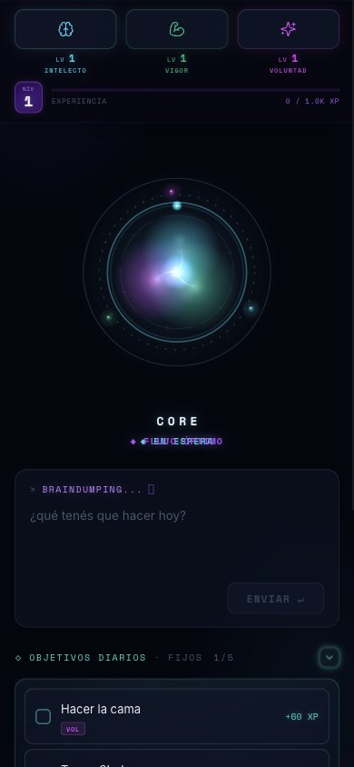

# FocusQuest (Onyx)

PWA de productividad pensada para personas con TDAH: escribís todo lo que tenés en la cabeza y la app lo convierte en misiones de un juego de rol, con submisiones cortas y un avatar que reacciona a tu avance.



## Qué hace

- **Brain dump → misiones.** El texto libre se envía a Gemini (`gemini-2.5-flash`) y vuelve como misiones con submisiones accionables.
- **Registro de misiones** en acordeones, con un protocolo diario y efectos de sonido y partículas al completar.
- **PWA instalable** en el celular.

## Stack

Next.js 14 (App Router) · React 18 · TypeScript · Tailwind · Framer Motion · Gemini API

## Decisiones

- **La API key nunca llega al navegador.** Vive en `GEMINI_API_KEY` (sin prefijo `NEXT_PUBLIC_`) y solo la usa el Route Handler `app/api/generate-quests/route.ts`. El cliente llama a `/api/generate-quests`.
- **Reglas para agentes de código en `CLAUDE.md`:** seguridad de la key, archivos que no se commitean y deuda técnica conocida.

## Cómo correrlo

```bash
cp .env.example .env.local   # completar GEMINI_API_KEY
npm install
npm run dev                  # http://localhost:5180
```

## Licencia

[MIT](LICENSE)
